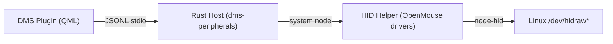

# DMS Peripherals

A DMS peripheral-management plugin powered by [OpenMouse](https://github.com/OpenMouse-Project).
This is an independent, unofficial plugin, not an OpenMouse or DMS release.


## Features

- Discover devices through the pinned OpenMouse mouse and keyboard driver registries, including devices awaiting Linux access permissions
- Show multiple devices in the bar, with independent visibility and mouse/keyboard icons
- Switch devices in the popout; click a bar device to open its controls
- Device-provided overview, performance, buttons and advanced settings
- Write settings through upstream drivers and read back the result
- Preserve the last successful reading, display its acquisition time, and color its age: green up to 60 seconds, amber up to five minutes, red afterward
- Keep seven days of battery samples, recorded every five minutes while DMS runs
- Provide narrow VID/PID udev commands; **unplug and reconnect the device/receiver after running them**, then recheck access

Available controls come from the upstream driver and returned capability flags. A matching driver is not a promise that every possible hardware feature exists in this plugin's UI. Errors from upstream are shown in the popout and can be reported through Issues.

## Requirements

- DMS 2.0 or newer on Linux x86_64
- System Node.js 20 or newer, available on DMS's PATH
- Linux HID access for the selected device

Node.js is not bundled or automatically installed. Runtime JS dependencies and the static Rust backend live inside the plugin directory. Runtime npm, Cargo, GTK development packages, or a running OpenMouse Bridge service are unnecessary.

## Install

Install **Peripherals** from the DMS plugin marketplace once its registry entry is merged. For manual installation:

```sh
git clone https://github.com/Trrrrw/dms-peripherals.git
cd dms-peripherals
scripts/install-local.sh
```

Enable **Peripherals** in DMS Settings → Plugins, then add it to your bar.
Open its settings to scan and add devices. The eye controls bar visibility; the device icon toggles the mouse/keyboard icon.

Uninstalling the plugin directory removes its runtime files. DMS-managed settings/history and system udev rules are separate user state.

## Architecture



## Development

Source is in `plugin/` (QML), `backend/src/` (Rust stdio host), and `backend/helper/` (OpenMouse driver integration). The runtime HID adapter is from OpenMouse Bridge at `30a3290ef88200f83a8083a88a3143d5e12eeaa8`.
`runtime/package-lock.json` pins protocol packages and native dependencies.

```sh
rustup target add x86_64-unknown-linux-musl
scripts/build-runtime.sh
cargo test --manifest-path backend/Cargo.toml --locked
cargo clippy --manifest-path backend/Cargo.toml --locked -- -D warnings
node --test tests/*.test.mjs
python3 tests/check-status.py
python3 tests/check-startup.py
python3 tests/check-refresh.py
python3 scripts/check-bundle.py
```

The QML checks require Quickshell. Generated runtime files are committed so the plugin marketplace can install without a compiler or npm. Run the build script after changing Rust, helper code, or dependency locks, and commit the updated runtime alongside its source.

To update an existing local installation, copy the QML/helper files and atomically replace a running executable (copy to a new filename, then rename). Restart DMS when helper QML or manifests change, since DMS may cache them.

## License and provenance

AGPL-3.0-or-later. See [LICENSE](LICENSE) and [THIRD_PARTY_NOTICES.md](THIRD_PARTY_NOTICES.md). Dependency license texts are included in the installable plugin.

Developed with AI assistance.
