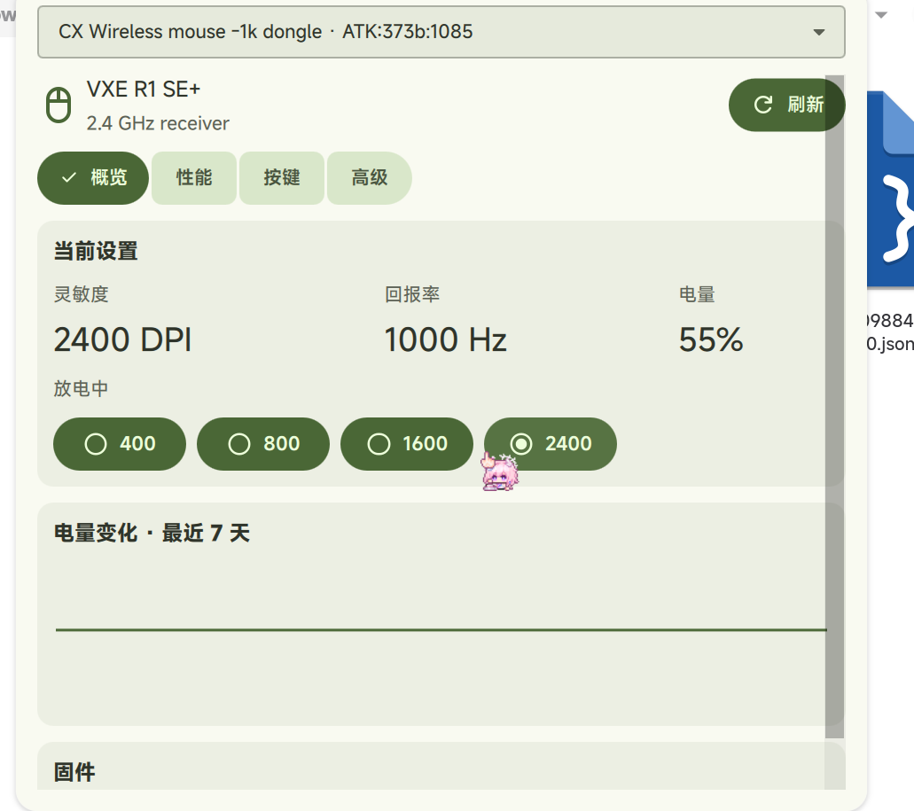
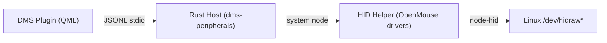

# DMS Peripherals

English | [简体中文](README.zh-CN.md)

A [DankMaterialShell (DMS)](https://github.com/AvengeMedia/DankMaterialShell) peripheral-management plugin powered by [OpenMouse](https://github.com/OpenMouse-Project).  
This is an independent, unofficial plugin, not an OpenMouse or DMS release.



## Features

- **Device discovery**: Detects supported mice and keyboards via pinned OpenMouse driver registries, including devices awaiting Linux HID permissions.
- **Multi-device bar & popout**: Shows multiple devices in the bar with independent visibility and mouse/keyboard icons; click any bar item to open its controls.
- **Verified settings**: Exposes driver-supported overview, performance (DPI stages, polling rate, LOD, signal processing), button debounce, and sleep controls, reading back each write to verify it applied.
- **Battery history & freshness**: Preserves the last successful reading with age indicators (green ≤ 60s, amber ≤ 5m, red > 5m) and records 7 days of battery history at 5-minute intervals.
- **Guided Linux permissions**: Generates narrow per-VID/PID `udev` rules right in Settings.

> Available controls depend on the upstream driver and its reported capabilities. Errors returned by upstream drivers are shown in the popout and can be reported via Issues.

## Requirements

- DMS 2.0 or newer on Linux x86_64
- System Node.js 20 or newer available on DMS's `PATH`
- Linux `hidraw` access for target devices

Node.js is not bundled or auto-installed. All other runtime dependencies and the static Rust host are bundled in `plugin/bin/`, so runtime `npm`, `cargo`, GTK dev packages, or a separate OpenMouse Bridge daemon are not required.

## Installation

Install **Peripherals** from the DMS plugin marketplace once available, or install manually:

```sh
git clone https://github.com/Trrrrw/dms-peripherals.git
cd dms-peripherals
scripts/install-local.sh
```

1. Enable **Peripherals** in **DMS Settings → Plugins** and add it to your bar.
2. Open the plugin settings to scan and add devices.
3. If a device requires Linux HID access, run the generated `udev` command, **unplug and reconnect the device/receiver**, and recheck access.

Uninstalling the plugin directory removes its runtime files; DMS-managed settings/history and system `udev` rules remain separate user state.

## Architecture



## Development

- `plugin/` — QML UI, service layer, and bundled installable runtime (`plugin/bin/`, `plugin/licenses/`)
- `backend/src/` — Static Rust stdio host
- `backend/helper/` — OpenMouse driver integration and HID descriptor parser
- `runtime/` — Pinned `package-lock.json` and the MIT-licensed HID adapter from OpenMouse Bridge (`30a3290ef88200f83a8083a88a3143d5e12eeaa8`)

Build and verify:

```sh
rustup target add x86_64-unknown-linux-musl
scripts/build-runtime.sh
cargo test --manifest-path backend/Cargo.toml --locked
cargo clippy --manifest-path backend/Cargo.toml --locked -- -D warnings
node --test tests/*.test.mjs
python3 tests/check-status.py
python3 tests/check-startup.py
python3 tests/check-refresh.py
python3 scripts/check-bundle.py
```

The QML checks require Quickshell. Generated runtime files under `plugin/bin/` are committed so the plugin marketplace can install directly without a compiler or `npm`—run `scripts/build-runtime.sh` after changing Rust, helper code, or lockfiles, and commit the updated runtime alongside the source. Run `scripts/install-local.sh` to atomically update a local installation and restart DMS.

## License

AGPL-3.0-or-later. See [LICENSE](LICENSE) and [THIRD_PARTY_NOTICES.md](THIRD_PARTY_NOTICES.md). Dependency license texts are bundled inside `plugin/licenses/`.

Developed with AI assistance.
