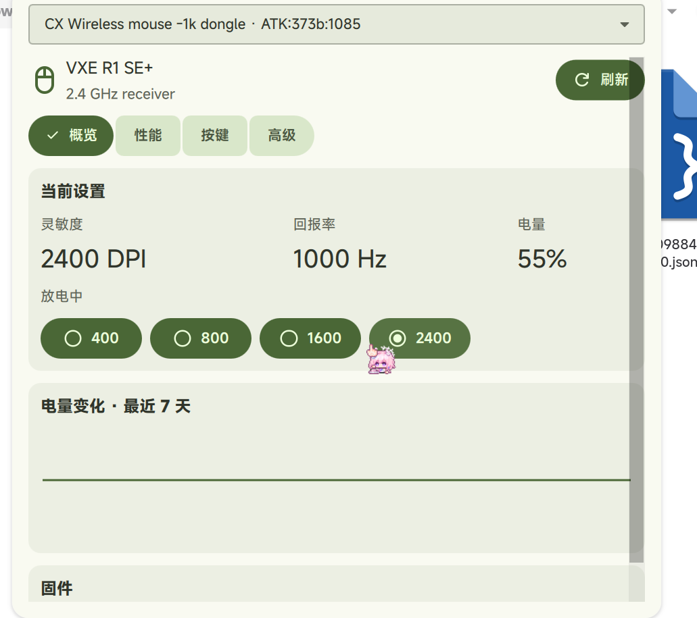
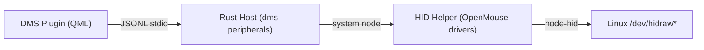

# DMS Peripherals

[English](README.md) | 简体中文

基于 [OpenMouse](https://github.com/OpenMouse-Project) 驱动协议的 [DankMaterialShell (DMS)](https://github.com/AvengeMedia/DankMaterialShell) 外设管理插件。  
本项目为独立第三方插件，非 OpenMouse 或 DMS 官方发布。



## 功能特性

- **设备发现**：通过锁定的 OpenMouse 鼠标与键盘驱动注册表自动发现设备，包括尚未授予 Linux HID 访问权限的设备。
- **多设备状态栏与弹窗**：支持在状态栏同时显示多个设备，可独立控制显示/隐藏与鼠标/键盘图标；点击状态栏设备即可打开对应控制面板。
- **写入回读校验**：按上游驱动能力提供概览、性能（DPI 档位、回报率、抬起高度、信号处理）、按键防抖与自动休眠设置，每次写入均强制回读验证。
- **电量曲线与时效提示**：保留上次成功读数并按获取时长着色（60 秒内绿色、5 分钟内黄色、超时红色）；DMS 运行期间每 5 分钟记录一次，保留最近 7 天电量曲线。
- **最小权限引导**：在插件设置中直接生成仅针对目标设备 VID/PID 的 `udev` 授权命令。

> 可用控制项取决于上游驱动及其返回的能力标志。上游驱动返回的错误会直接在弹窗中展示，欢迎通过 Issue 反馈。

## 环境要求

- Linux x86_64 下的 DMS 2.0 或更新版本
- 系统已安装 Node.js 20 或更新版本，且位于 DMS 的 `PATH` 中
- 目标设备的 Linux `hidraw` 访问权限

插件不会内置或自动安装 Node.js。其余运行时依赖与静态编译的 Rust 后端已打包在 `plugin/bin/` 中，运行时无需 `npm`、`cargo`、GTK 开发包，也无需后台运行 OpenMouse Bridge 服务。

## 安装与使用

待插件市场收录后可直接安装 **Peripherals**，也可手动安装：

```sh
git clone https://github.com/Trrrrw/dms-peripherals.git
cd dms-peripherals
scripts/install-local.sh
```

1. 在 **DMS 设置 → 插件** 中启用 **Peripherals**，并将其添加到状态栏。
2. 打开插件设置扫描并添加设备。
3. 若设备提示缺少 Linux 访问权限，运行设置页生成的 `udev` 授权命令，**拔掉并重新插入设备或接收器**，再点击“重新检测”。

卸载插件目录即可清除全部运行时文件；DMS 保存的插件设置、历史电量记录与系统 `udev` 规则为独立用户状态。

## 项目架构



## 本地开发

- `plugin/` — QML 界面、服务层以及可直接安装的内置运行时（`plugin/bin/`、`plugin/licenses/`）
- `backend/src/` — 静态编译的 Rust stdio 宿主进程
- `backend/helper/` — OpenMouse 驱动集成与 HID 描述符解析
- `runtime/` — 锁定版本的 `package-lock.json` 与源自 OpenMouse Bridge（`30a3290ef88200f83a8083a88a3143d5e12eeaa8`，MIT）的 HID 适配器

构建与测试：

```sh
rustup target add x86_64-unknown-linux-musl
scripts/build-runtime.sh
cargo test --manifest-path backend/Cargo.toml --locked
cargo clippy --manifest-path backend/Cargo.toml --locked -- -D warnings
node --test tests/*.test.mjs
python3 tests/check-status.py
python3 tests/check-startup.py
python3 tests/check-refresh.py
python3 scripts/check-bundle.py
```

QML 检查需要本地安装 Quickshell。仓库提交了 `plugin/bin/` 下的生成运行时，以便插件市场免编译、免 `npm` 直接安装；修改 Rust 代码、helper 或依赖锁文件后，请重新运行 `scripts/build-runtime.sh` 并一并提交更新后的运行时。本地更新安装可直接运行 `scripts/install-local.sh`（会自动原子替换二进制并重启 DMS）。

## 许可证

AGPL-3.0-or-later，详见 [LICENSE](LICENSE) 与 [THIRD_PARTY_NOTICES.md](THIRD_PARTY_NOTICES.md)。各依赖的许可证文本已随包附带于 `plugin/licenses/` 中。

本项目在 AI 辅助下开发。
